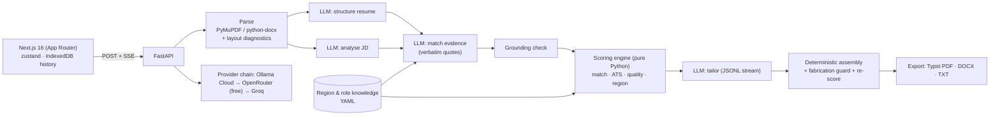

# Shortlist: India-first Resume Customizer

Paste a job description, upload a resume (PDF or DOCX), and get:

- **Evidence-backed scores:** JD match, ATS, content quality and region fit, each with an itemised "why".
- **A ranked list of fixes** and a recruiter's 7-second verdict.
- **A truthfully tailored resume:** streamed live, with a diff, multiple versions and PDF/DOCX/TXT downloads.
- **A matching cover letter.**

**Live app:** _URL added after the Render deploy_ (blueprint services `shortlist-resume-web-aayush` and `shortlist-resume-api-aayush`)

> The free hosting tier sleeps when idle. The first request can take up to a minute while the server wakes, and the UI says so.

## What makes it different

1. **The LLM never invents a number.**
   - The model only extracts evidence: JD requirements, then a per-requirement judgment with a quote copied verbatim from the resume.
   - Every quote is fuzzy-verified against the resume. Unverifiable claims are downgraded.
   - All scores are computed in Python from that evidence with a published rubric. The same inputs give the same scores.
2. **India-first judgment.** Region packs (`backend/app/knowledge/regions/*.yaml`) encode how recruiters actually read resumes:
   - **India**, by employer type (product/startup, IT services, GCC, consulting/MBA, BFSI, PSU/Govt):
     - personal details and "Declaration" sections are flagged as dated for product companies but accepted for PSU roles;
     - CGPA and 10th/12th marks are expected for freshers in services hiring;
     - Naukri, notice-period and LeetCode advice where relevant.
   - **International** (Indians applying abroad):
     - photo, DOB and marital status are flagged as discrimination-law risks;
     - CTC and Lakh/Crore get rewrite suggestions;
     - work-authorisation guidance.
3. **No fabrication.**
   - Tailoring may rephrase, reorder and mirror JD wording only for evidenced skills.
   - Companies, titles and dates are copied by code, never by the model.
   - Any number, tool or name in the output that isn't in the original is flagged **"Needs your confirmation"**.
   - Missing skills become **"Add only if true"** suggestions with `[placeholders]`.

## Features (brief → implementation)

| Requirement | How |
|---|---|
| JD input + validation | Textarea with live word/char count, 300–20,000 chars, and a warning when the text isn't a JD |
| PDF/DOCX upload | Drag and drop; shows name and size; magic-byte check, ≤ 5 MB, ≤ 5 pages; detects scanned, encrypted, multi-column and hidden-text files |
| LLM customisation | Summary rewrite, matched skills first, bullets reordered and rephrased, missing keywords |
| View + download | Clean resume view; **PDF** (Typst, ATS-safe single column, A4 for India, Letter for International), **DOCX**, **TXT** |
| Error handling | Typed error codes with friendly messages, LLM provider fallback chain, per-IP rate limit (proxy-aware), request size cap, partial results kept on failure, retry of just the failed step |
| ★ Match score | Weighted requirement coverage, before → after |
| ★ ATS score | Parseability, keyword coverage, structure and length, itemised |
| ★ Diff view | Bullet-aligned (stable IDs), word-level, reorder markers, the reason for each change |
| ★ Multiple versions | Re-tailor the same analysis with different sections/tone/model; compare any two |
| ★ Section-wise | Choose Summary / Skills / Experience / Projects / Education / Achievements |
| ★ Cover letter | Streamed and editable; region conventions; notice period / work authorisation |
| ★ Streaming | SSE pipeline stages plus rewritten lines appearing live |
| Extras | Region switch, recruiter verdict, "How we score" panel, browser-only history (no login), sample data |

## Architecture



- **Backend** (`backend/app`):
  - `parsing/` turns files into text plus ATS layout signals.
  - `llm/` holds the provider-chain client and versioned prompts.
  - `knowledge/` holds the region packs, role families and lexicons.
  - `scoring/` computes the scores; `guard/` holds the grounding and fabrication checks.
  - `tailoring.py`, `export/` and `services/` hold the streaming pipelines.
- **The backend is stateless:** the browser holds the analysis and sends it back for new versions and cover letters.
- **Frontend** (`frontend/`):
  - typed SSE client, run-scoped store (stale streams can't write into newer results);
  - "Meridian" ledger design system: warm black, hairline rules, one gilt accent.

## LLM providers and models

All free:

| Role | Default | Fallbacks |
|---|---|---|
| Extraction & judgment | Ollama Cloud `gpt-oss:120b` | Ollama `nemotron-3-super` → OpenRouter `nvidia/nemotron-3-super-120b-a12b:free` → `google/gemma-4-31b-it:free` |
| Writing (tailor, letter) | Ollama Cloud `gpt-oss:120b` | same chain |

- **Why gpt-oss:120b:** Ollama's free plan serves four models (gpt-oss:120b, nemotron-3-ultra, nemotron-3-super, gemma4:31b); Kimi, MiniMax, DeepSeek-Pro and GLM need Pro. All four were evaluated on this pipeline (below), and gpt-oss:120b gave 100% grounding with low variance at ~22 s per analysis. The larger Nemotron-3-Ultra matched its grounding but varied more and took ~4.4 min per analysis. Community "kimi-k3" uploads on Ollama are `gemma4:31b` behind a renamed system prompt, not Moonshot's model.
- **Upgrading:** set `OLLAMA_WRITER_MODELS=kimi-k2.6,...` with a Pro key, or point `OPENROUTER_*` at paid models. No code change is needed.
- **Picking a model in the UI:** users can choose the writing model under *Advanced*.
- **Every structured call:**
  - asks for JSON-schema output and also embeds the schema in the prompt (some servers accept `json_schema` without enforcing it);
  - is validated with Pydantic, gets one repair round, then falls back to the next provider.

## Accuracy evaluation

`backend/evals/run_eval.py` runs the real pipeline live: the same resume analysed 3 times, a strong resume vs the weaker sample, and the share of LLM quotes found verbatim in the resume. Results for every model on Ollama's free plan (2026-10-13):

| Model | Overall score, 3 runs | σ (gate ≤ 3) | Strong vs weak | Quote grounding (gate ≥ 98%) | Time per analysis |
|---|---|---|---|---|---|
| **gpt-oss:120b** (default) | 59 / 60 / 61 | 0.82 | 92 > 59 | **100%** | **~22 s** |
| nemotron-3-ultra | 59 / 61 / 58 | 1.25 | 88 > 59 | 100% | ~265 s |
| nemotron-3-super (fallback) | 57 / 58 / 58 | 0.47 | 92 > 57 | 100% | ~123 s |
| gemma4:31b | 58 / 57 / 58 | 0.47 | 97 > 58 | 95% ✗ | ~14 s |

Quality and region sub-scores were identical across every run and model (44 / 75), because they're computed by code from the resume itself. Unverified quotes are always downgraded, never credited.

## Run locally

```bash
# backend (Python 3.12+)
cd backend && python3 -m venv .venv && .venv/bin/pip install -r requirements.txt -r requirements-dev.txt
cp .env.example .env    # add OLLAMA_API_KEY (ollama.com) and/or OPENROUTER_API_KEY
.venv/bin/uvicorn app.main:app --reload --port 8000
```

- **Keyless local LLM:** if you're signed in to Ollama locally, set `OLLAMA_BASE_URL=http://localhost:11434/v1` and `OLLAMA_*_MODELS=gpt-oss:120b-cloud` instead of an API key.

```bash
# frontend (Node 20+, pnpm)
cd frontend && pnpm install && cp .env.example .env.local && pnpm dev   # http://localhost:3000
```

**Tests:**
- `cd backend && .venv/bin/pytest -q && .venv/bin/ruff check .` (125 tests)
- `cd frontend && pnpm test && pnpm tsc --noEmit` (20 tests)

**Live eval:** `cd backend && .venv/bin/python -m evals.run_eval --runs 3`

## Deploy

`render.yaml` defines both services (Docker API and Node frontend) on Render's free plan.

- **Secrets:** set `OLLAMA_API_KEY`, `OPENROUTER_API_KEY` and `ALLOWED_ORIGINS` on the API, and `NEXT_PUBLIC_API_URL` on the frontend.
- **Keep-warm:** UptimeRobot pings `/health` and `/api/health` every 5 minutes.

## Known limitations and trade-offs

- **ATS score:** an estimate. Real ATS products don't publish scores; this models common parsing and keyword-filter behaviour.
- **Scanned PDFs:** rejected with a clear message (no OCR).
- **Free tiers:** rate limits and cold starts are real. The provider chain, input caching and the UI's wake-up notice mitigate them.
- **Region packs:** researched, curated heuristics. The India pack and the lexicons were fact-checked; the International pack is a reviewed draft.
- **Model sizes:** free models are smaller than paid frontier ones; prose quality improves with a Pro/paid writer model via env vars.
- **No login** (by request). History lives only in the user's browser; resumes are never stored server-side.
