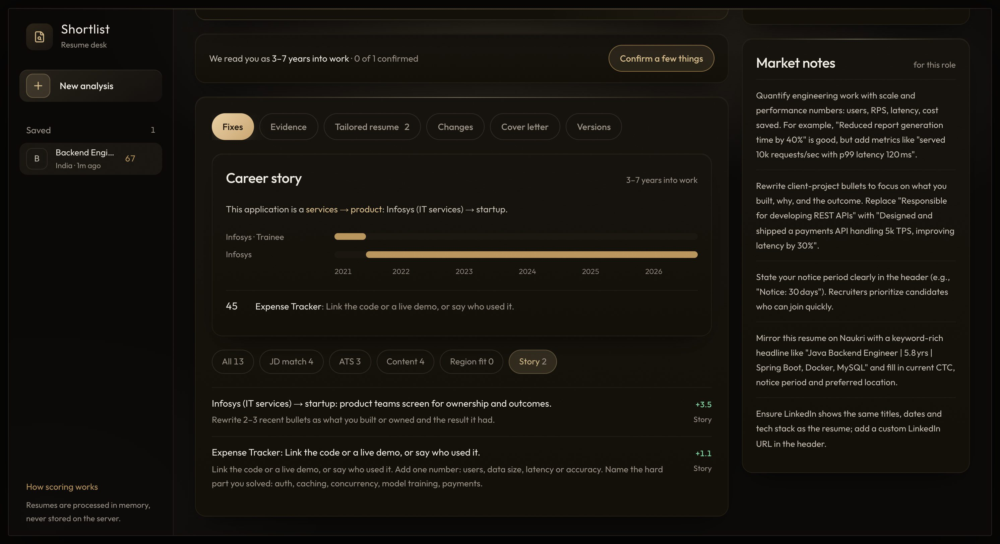
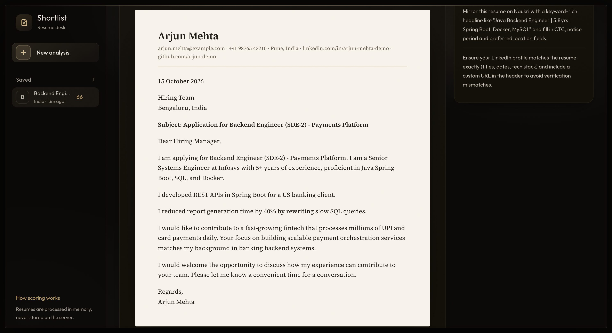
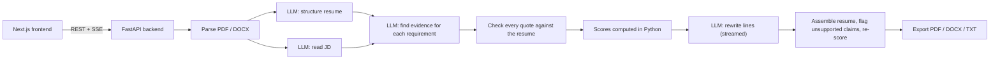

# Shortlist: Resume Customizer

Paste a job description and upload a resume (PDF or DOCX). Shortlist scores how well the resume fits the job, explains every point it takes off, rewrites the resume for the job without inventing anything, and writes a matching cover letter.

**Live app:** https://shortlist-resume-web-aayush-1son.onrender.com
**API health:** https://shortlist-resume-api-aayush-v0yd.onrender.com/health

The free hosting tier sleeps when idle, so the first request can take up to a minute. The UI shows a notice while the server wakes up.

## Demo

A 90-second walkthrough of the live app: why it was built, how it works, then the full flow with the built-in sample, from scores and evidence to the tailored resume, the changes and the cover letter. Watch [docs/demo.mp4](docs/demo.mp4). The two waits (the analysis and the cover letter) are sped up.

## Screenshots

All taken from the live app with the built-in sample (an Infosys engineer applying for a Bengaluru SDE-2 payments role).

| | |
|---|---|
|  **Input.** Paste a JD, drop a PDF or DOCX (name and size shown), pick the hiring market and the sections to tailor. |  **Streaming.** Each pipeline stage reports as it runs. Scores arrive first, then rewritten lines stream in while tailoring runs. |
|  **Results.** Overall score and five sub-scores with before/after changes, ranked fixes, a recruiter's first impression and India market notes. |  **Evidence.** Every requirement in the JD with its weight, its status and the exact resume line that proves it. |
|  **Tailored resume.** JD terms are highlighted. Anything the original doesn't say is flagged "Needs your confirmation" with a one-click revert. Download as PDF, DOCX or TXT. |  **Changes.** Inline or side-by-side diff with moved-bullet markers and the reason for each edit. |
|  **Career story.** A score judged for the candidate's stage: a timeline of roles, the career move this application represents, and how each project reads. |  **Cover letter.** A one-page business letter built from the resume's strongest evidence, shown as it will print. Sentences the resume doesn't back up are left out. Edit, copy, or download as PDF, DOCX or TXT. |

## Features

| Brief | What the app does |
|---|---|
| JD input | Textarea with a live word and character count, 300 to 20,000 characters, and a warning when the text doesn't look like a JD |
| Resume upload | Drag and drop or browse; shows file name and size; checks file type, size (5 MB) and pages (5); detects scanned, encrypted and multi-column files |
| LLM customisation | Rewrites the summary, puts matched skills first, reorders and rephrases bullets, lists missing keywords |
| Output and download | Clean resume view; PDF (single column, A4 for India, Letter for international), DOCX and TXT |
| Error handling | Friendly messages for every error code, a fallback chain across LLM providers, rate limiting, request size limits, and a retry for just the step that failed |
| Match score (bonus) | Weighted coverage of the JD's requirements, before and after tailoring |
| ATS score (bonus) | Parseability, keyword coverage, structure and length, each itemised |
| Diff view (bonus) | Word-level diff aligned by bullet, with reorder markers and reasons |
| Multiple versions (bonus) | Re-tailor with different sections, tone or model and compare any two versions |
| Section-wise customisation (bonus) | Choose Summary, Skills, Experience, Projects, Education, Achievements |
| Cover letter (bonus) | A one-page business letter (date, recipient, subject, greeting, sign-off) with an editable paper preview and PDF/DOCX/TXT download |
| Streaming (bonus) | Server-sent events for pipeline stages and rewritten lines |
| Extras | India and international scoring, career-stage scoring with a short follow-up questionnaire, saved history in the browser (no login), sample data |

## Tech stack

- **Frontend:** Next.js 16 (App Router), React 19, TypeScript, Tailwind CSS 4, shadcn/ui, zustand, idb-keyval for browser history, Vitest
- **Backend:** Python 3.12, FastAPI, Pydantic v2, PyMuPDF and python-docx for parsing, Typst for PDF output, rapidfuzz, pytest and ruff
- **LLM access:** the `openai` Python SDK against OpenAI-compatible endpoints
- **Hosting:** Render (Docker for the API, Node for the frontend)

## LLM providers and models

Providers are tried in the order set by `LLM_PROVIDER_ORDER`; a provider without an API key is skipped. All of them have free tiers.

| Provider | Default models | Notes |
|---|---|---|
| Ollama Cloud | `gpt-oss:120b`, then `nemotron-3-super` | Default. Fast enough (about 22 s per analysis) and every quote it returned was found in the resume |
| Gemini (Google AI Studio) | `gemini-2.5-flash`, then `gemini-2.5-flash-lite` | Uses Google's OpenAI-compatible endpoint. The free tier allows about 10 requests a minute, so put it first only for light use |
| Groq | `openai/gpt-oss-120b` | Same model family as the default, very fast |
| OpenRouter | `nvidia/nemotron-3-super-120b-a12b:free`, `google/gemma-4-31b-it:free` | Last resort |

Every structured call asks for JSON schema output, validates it with Pydantic, gets one repair attempt, and then falls back to the next model. Users can also pick the writing model under **Advanced options**.

I compared the four models on Ollama's free plan with `backend/evals/run_eval.py` (three runs of the same resume, a strong resume against a weaker one, and the share of quotes found word for word in the resume):

| Model | Overall score over 3 runs | Strong vs weak | Quotes found in resume | Time per analysis |
|---|---|---|---|---|
| **gpt-oss:120b** (default) | 59 / 60 / 61 | 92 vs 59 | **100%** | **~22 s** |
| nemotron-3-ultra | 59 / 61 / 58 | 88 vs 59 | 100% | ~265 s |
| nemotron-3-super | 57 / 58 / 58 | 92 vs 57 | 100% | ~123 s |
| gemma4:31b | 58 / 57 / 58 | 97 vs 58 | 95% | ~14 s |

## How it works



The main design choice: **the model reads and writes, but code decides.**

- **Scoring is plain Python.** The model's job is to find evidence: for each JD requirement it has to point at a resume line and quote it word for word. Code checks every quote against the resume and downgrades any it can't find. Facts that can be read directly, like years of experience from the dates, degree level and certifications, are worked out in code. The same inputs always give the same scores.
- **The resume can't gain new facts.** Company names, titles and dates are copied by code. After the model rewrites a line, code flags any number, tool or name that isn't in the original, and any wording borrowed from the JD that the original doesn't support (for example "payments module" becoming "payment orchestration module"). The user sees these flags and can revert any line.
- **The cover letter follows the same rule.** The model writes the paragraphs as JSON; code adds the date, recipient, subject line, greeting and sign-off, and drops any sentence that is a cliché or claims something the resume doesn't say.
- **India first.** Region packs in `backend/app/knowledge/regions/` hold the rules recruiters actually apply: personal details and declaration sections are fine for PSU roles but read as dated at product companies, CGPA matters for freshers in services hiring, and photos and date of birth are flagged for applications abroad.
- **Career stage.** `backend/app/profile/` reads the work history from the resume's dates and judges it for the candidate's stage (student, fresh graduate, 1 to 3, 3 to 7 or 7+ years): projects, internships, gaps, short stints, and moves like services to product or a field switch. Where only the candidate knows the answer (why a gap, whether a short role was a contract), the app asks, then re-scores instantly without another model call.

Score weights (India): JD match 35%, ATS 20%, content 15%, region fit 10%, career story 20%. The "How scoring works" panel in the app lists the full rubric.

### Code layout

```
backend/app/
  api/         routes, rate limiting, error handling
  parsing/     PDF and DOCX text extraction plus layout checks
  llm/         provider client and prompt templates
  judging.py   requirement matching done in code
  scoring/     match, ATS, content quality and region scores
  profile/     career stage, timeline, projects and follow-up questions
  guard/       quote checks and the fabrication check
  services/    the streaming analyse, tailor and cover letter flows
  export/      PDF (Typst), DOCX and TXT
frontend/
  app/         the single page
  components/  input form, score board, tabs and panels
  lib/         API client, SSE parsing, store, history
```

The backend keeps no state. The browser stores each analysis and sends it back when the user re-tailors, answers a question or writes a cover letter.

## Accuracy

`backend/evals/accuracy.py` checks the evidence step against hand-written labels: a recruiter-style status for every requirement of a Bengaluru SDE-2 job, for one strong and one weaker resume. On the current version, five runs agree with the labels on **98.8% of 160 judgments**. The strong resume scores 97 overall on every run, and the weaker one scores between 58 and 61.

The biggest source of run-to-run variation was the model reading the JD's requirements differently each time, so the requirement list is now parsed from the JD's own bullets in code.

## Run locally

```bash
# backend (Python 3.12+)
cd backend
python3 -m venv .venv
.venv/bin/pip install -r requirements.txt -r requirements-dev.txt
cp .env.example .env          # add at least one key: OLLAMA_API_KEY, GEMINI_API_KEY or GROQ_API_KEY
.venv/bin/uvicorn app.main:app --reload --port 8000
```

```bash
# frontend (Node 20+, pnpm)
cd frontend
pnpm install
cp .env.example .env.local    # NEXT_PUBLIC_API_URL=http://localhost:8000
pnpm dev                      # http://localhost:3000
```

Where to get free keys: Ollama at ollama.com/settings/keys, Gemini at aistudio.google.com/apikey, Groq at console.groq.com/keys.

**Tests:**

```bash
cd backend && .venv/bin/pytest -q && .venv/bin/ruff check .
cd frontend && pnpm test && pnpm lint
```

## Deploy

`render.yaml` defines both services on Render's free plan.

- Set the provider keys (`OLLAMA_API_KEY`, `GEMINI_API_KEY`, `GROQ_API_KEY`, `OPENROUTER_API_KEY`) and `ALLOWED_ORIGINS` on the API service, and `NEXT_PUBLIC_API_URL` on the frontend.
- Render adds a random suffix to service hostnames, so copy the real URLs from each service page. The API URL is built into the frontend, so rebuild it after changing `NEXT_PUBLIC_API_URL`.
- Render's `/usr/bin` is read-only, so the build calls `corepack pnpm` instead of `corepack enable`.
- An UptimeRobot monitor pings `/health` and `/api/health` every 5 minutes to keep both services awake.

## Limitations and trade-offs

- **The ATS score is an estimate.** Real ATS products don't publish scores; this models common parsing and keyword-filter behaviour.
- **Scanned PDFs are rejected** with a clear message; there's no OCR.
- **Free tiers are slow and rate-limited.** A full analysis and tailoring run takes one to two minutes. The provider fallback chain and input caching help, but a busy free provider can still slow things down.
- **Free models write less polished prose** than paid ones. Setting a paid model through environment variables improves it without code changes.
- **Region rules are curated heuristics.** The India pack was checked against hiring guides; the international pack is a reviewed first draft.
- **No login.** History lives only in the user's browser, and resumes are never stored on the server.
