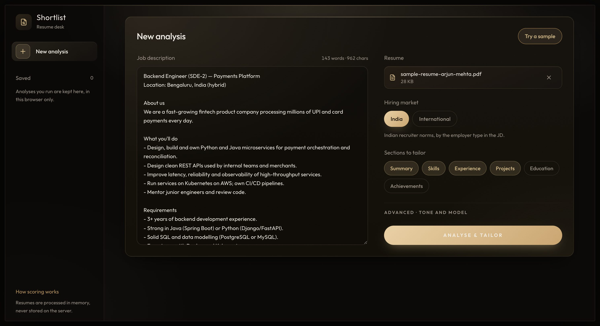
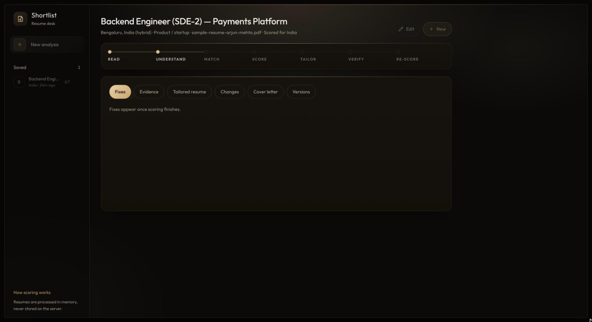
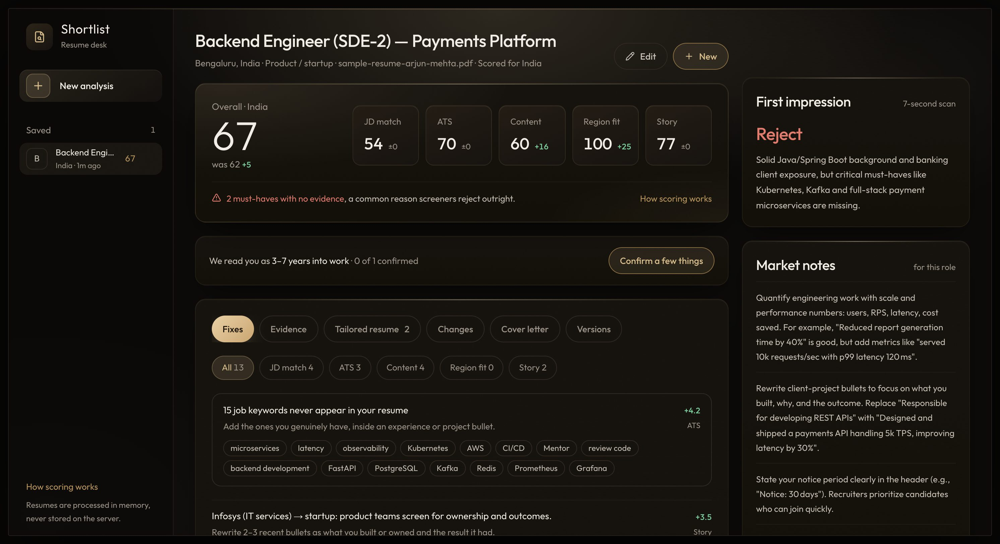
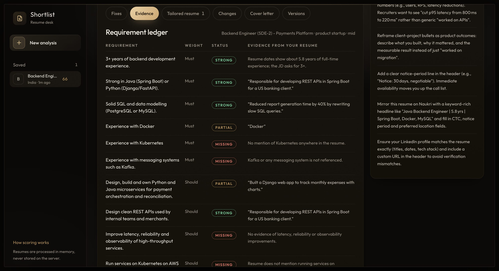
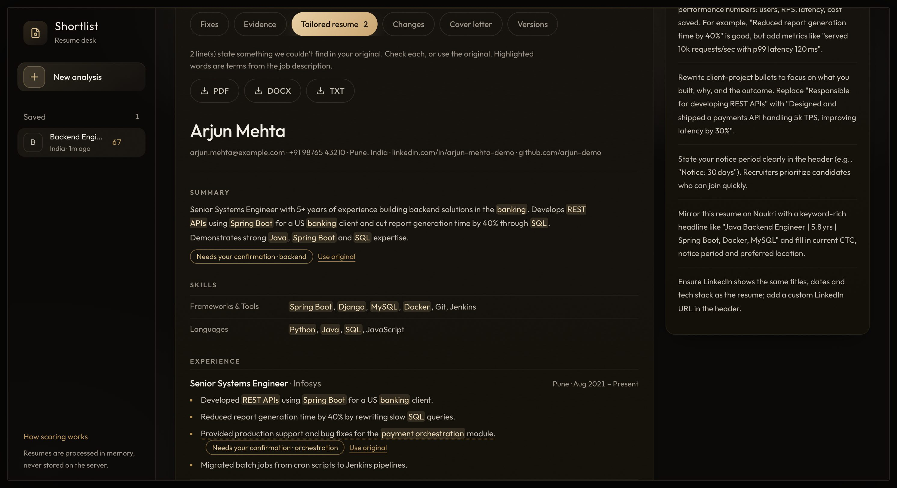
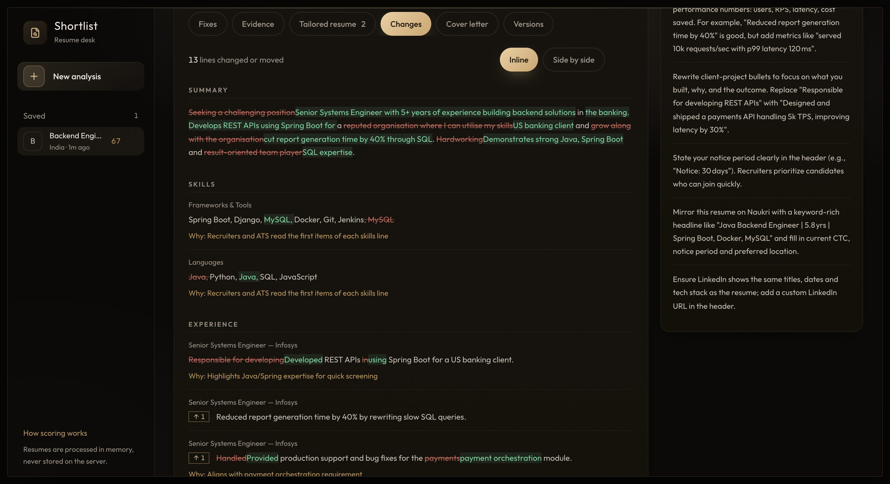
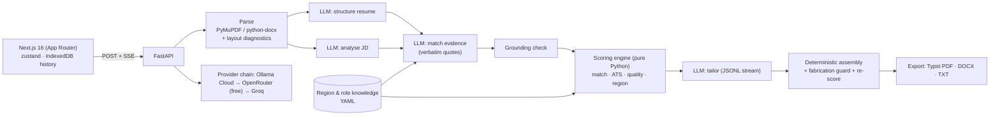

# Shortlist: India-first Resume Customizer

Paste a job description, upload a resume (PDF or DOCX), and get:

- **Evidence-backed scores:** JD match, ATS, content quality and region fit, each with an itemised "why".
- **A ranked list of fixes** and a recruiter's 7-second verdict.
- **A truthfully tailored resume:** streamed live, with a diff, multiple versions and PDF/DOCX/TXT downloads.
- **A matching cover letter.**

**Live app:** https://shortlist-resume-web-aayush-1son.onrender.com · API: https://shortlist-resume-api-aayush-v0yd.onrender.com/health

> The free hosting tier sleeps when idle. The first request can take up to a minute while the server wakes, and the UI says so.

## Screenshots

All from the live app, using the built-in sample (an Infosys engineer applying for a Bengaluru SDE-2 payments role).

| | |
|---|---|
|  **Input.** Paste a JD, drop a PDF/DOCX (name and size shown), pick region, tone and sections. |  **Streaming.** Seven stages report live as they run: read, understand, match, score, tailor, verify, re-score. |
|  **Results.** Overall and four sub-scores with before→after deltas, ranked fixes, the 7-second verdict and India market notes. |  **Evidence.** Every JD requirement with its status and the verbatim resume quote that proves it. |
|  **Tailored resume.** JD terms highlighted; unverifiable lines flagged "Needs your confirmation", with a one-click revert. Download as PDF, DOCX or TXT. |  **Changes.** Inline or side-by-side diff with moved-bullet markers and a reason for each edit. |

## What makes it different

1. **The LLM never invents a number.**
   - The model only extracts evidence: JD requirements, then a per-requirement judgment with a quote copied verbatim from the resume.
   - Every quote is fuzzy-verified against the resume. Unverifiable claims are downgraded.
   - All scores are computed in Python from that evidence with a published rubric. The same inputs give the same scores.
2. **India-first judgment.** Region packs (`backend/app/knowledge/regions/*.yaml`) encode how recruiters actually read resumes:
   - **India**, by employer type (product/startup, IT services, GCC, consulting/MBA, BFSI, PSU/Govt):
     - personal details and "Declaration" sections are flagged as dated for product companies but accepted for PSU roles;
     - CGPA and 10th/12th marks are expected for freshers in services hiring;
     - Naukri, notice-period and LeetCode advice where relevant.
   - **International** (Indians applying abroad):
     - photo, DOB and marital status are flagged as discrimination-law risks;
     - CTC and Lakh/Crore get rewrite suggestions;
     - work-authorisation guidance.
3. **No fabrication.**
   - Tailoring may rephrase, reorder and mirror JD wording only for evidenced skills.
   - Companies, titles and dates are copied by code, never by the model.
   - Any number, tool or name in the output that isn't in the original is flagged **"Needs your confirmation"**.
   - Missing skills become **"Add only if true"** suggestions with `[placeholders]`.

## Features (brief → implementation)

| Requirement | How |
|---|---|
| JD input + validation | Textarea with live word/char count, 300–20,000 chars, and a warning when the text isn't a JD |
| PDF/DOCX upload | Drag and drop; shows name and size; magic-byte check, ≤ 5 MB, ≤ 5 pages; detects scanned, encrypted, multi-column and hidden-text files |
| LLM customisation | Summary rewrite, matched skills first, bullets reordered and rephrased, missing keywords |
| View + download | Clean resume view; **PDF** (Typst, ATS-safe single column, A4 for India, Letter for International), **DOCX**, **TXT** |
| Error handling | Typed error codes with friendly messages, LLM provider fallback chain, per-IP rate limit (proxy-aware), request size cap, partial results kept on failure, retry of just the failed step |
| ★ Match score | Weighted requirement coverage, before → after |
| ★ ATS score | Parseability, keyword coverage, structure and length, itemised |
| ★ Diff view | Bullet-aligned (stable IDs), word-level, reorder markers, the reason for each change |
| ★ Multiple versions | Re-tailor the same analysis with different sections/tone/model; compare any two |
| ★ Section-wise | Choose Summary / Skills / Experience / Projects / Education / Achievements |
| ★ Cover letter | Streamed and editable; region conventions; notice period / work authorisation |
| ★ Streaming | SSE pipeline stages plus rewritten lines appearing live |
| ★ Career story | A fifth score judged for the candidate's stage (2nd/3rd/4th-year student, fresh graduate, 1–3 / 3–7 / 7+ years): projects read for real work, internships and apprenticeships, gaps, short stints, and the move this application represents (services → product, startup → MNC, MNC → mega-MNC, field switch) |
| ★ Clarify step | After scoring, up to six questions only the candidate can answer (why a gap, what a short role was, what "Zephyr" is). Answers re-score instantly in code (no model call) and carry into the next tailored version |
| Extras | Region switch, recruiter verdict, "How we score" panel, browser-only history (no login), sample data |

## Architecture



- **Backend** (`backend/app`):
  - `parsing/` turns files into text plus ATS layout signals.
  - `llm/` holds the provider-chain client and versioned prompts.
  - `knowledge/` holds the region packs, role families and lexicons.
  - `scoring/` computes the scores; `guard/` holds the grounding and fabrication checks.
  - `tailoring.py`, `export/` and `services/` hold the streaming pipelines.
- **The backend is stateless:** the browser holds the analysis and sends it back for new versions and cover letters.
- **Frontend** (`frontend/`):
  - typed SSE client, run-scoped store (stale streams can't write into newer results);
  - "Meridian" ledger design system: warm black, hairline rules, one gilt accent.

## LLM providers and models

All free:

| Role | Default | Fallbacks |
|---|---|---|
| Extraction & judgment | Ollama Cloud `gpt-oss:120b` | Ollama `nemotron-3-super` → OpenRouter `nvidia/nemotron-3-super-120b-a12b:free` → `google/gemma-4-31b-it:free` |
| Writing (tailor, letter) | Ollama Cloud `gpt-oss:120b` | same chain |

- **Why gpt-oss:120b:** Ollama's free plan serves four models (gpt-oss:120b, nemotron-3-ultra, nemotron-3-super, gemma4:31b); Kimi, MiniMax, DeepSeek-Pro and GLM need Pro. All four were evaluated on this pipeline (below), and gpt-oss:120b gave 100% grounding with low variance at ~22 s per analysis. The larger Nemotron-3-Ultra matched its grounding but varied more and took ~4.4 min per analysis. Community "kimi-k3" uploads on Ollama are `gemma4:31b` behind a renamed system prompt, not Moonshot's model.
- **Upgrading:** set `OLLAMA_WRITER_MODELS=kimi-k2.6,...` with a Pro key, or point `OPENROUTER_*` at paid models. No code change is needed.
- **Picking a model in the UI:** users can choose the writing model under *Advanced*.
- **Every structured call:**
  - asks for JSON-schema output and also embeds the schema in the prompt (some servers accept `json_schema` without enforcing it);
  - is validated with Pydantic, gets one repair round, then falls back to the next provider.

## How judging works (code first, model second)

The free models are capable but not reliable judges, so every decision that can be made from facts is made in code (`backend/app/judging.py`). The model gets one narrow job, under a numbered procedure.

| Decision | Who decides | How |
|---|---|---|
| "N+ years of experience" | **Code** | Years computed from the resume's own dates. Internships are excluded, overlapping roles count once and back-to-back roles merge. |
| Degree requirements | **Code** | Degree level detected: B.Tech/B.E./BSc/BCA < M.Tech/MSc/MCA/MBA/PGDM < PhD. |
| Certifications | **Code** | The core name (e.g. "AWS") must appear together with a certification word. |
| A named skill or tool | **Code floor** | Only skills the requirement actually names count, via ~120 canonical skills plus synonyms and inflections. A bullet that shows the work = strong. A duty-style bullet, the skills list, or only part of an "X and Y" requirement = partial. "X or Y" and "X (e.g. Y)" accept any one. |
| The same skill in other words ("Spring Boot" → Java, "trained interns" → mentoring) | **Model** | It must cite a bullet ID and an exact quote. Code verifies the quote; the model can only raise a status above the code floor, never lower it, and never overrule a code fact. |
| Scores, knockouts, ranked fixes | **Code** | Computed from the reconciled evidence (rubric below). |

Tailoring is planned the same way (`backend/app/tailor_plan.py`):
- **Order:** bullet order comes from the weight of the requirements each bullet proves.
- **Skills:** JD-matched skills move first and nothing is dropped.
- **Mirroring:** each line may mirror a JD term only if it already says the same thing in other words (`k8s` → `Kubernetes`).
- **Must rewrite:** lines with a weak opener are marked; if the model returns one unchanged, it gets one targeted repair call.
- **Padding removal:** trailing outcome clauses the original never stated ("…, improving reliability") are deleted in code before the fabrication guard runs.

### Career story (stage-aware, `backend/app/profile/`)

The same split applies to the candidate's history. Code reads the timeline from the resume's dates, then judges it for the stage the candidate is at; the model's only job is to quote what each project does.

- **Stage**: a degree ending after today with under a year of full-time work is a student, and the study year counts back from graduation by course length (B.Tech 4, BCA/BSc 3, MBA 2). Otherwise: fresh graduate (< 1 year), 1–3, 3–7 or 7+ years. Internships, NATS/NAPS apprenticeships and virtual simulations (Forage) never count as full-time work.
- **Gaps and short stints**: breaks between study and work, and roles under a year. Year-only dates widen to the whole year, so imprecise dates never create a flag. Degrees taken mid-career (an MBA) are not gaps.
- **Moves**: employers are classified from a curated India-first list (`employers.yaml`: services, product, MNC, mega-MNC, govt); unknown ones become a question, never a guess. The target move is the latest role against the JD's employer and field.
- **Projects**: purpose 25 · original (not a todo/weather/Netflix-clone tutorial, or one with a stated extension) 20 · real use 20 · numbers 15 · technical depth 20 · −5 per custom name nobody explained. "Zephyr" is never treated as an unknown skill; it only needs five words saying what it is.

| Component | Student · fresh graduate | 1–3 years | 3+ years |
|---|---|---|---|
| Projects | 40 | 20 | 10 |
| Internships / apprenticeships | 25 | 5 | — |
| Presentation (graduation year, CGPA, profile link) | 20 | 10 | — |
| Continuity (gaps) | 15 | 20 | 25 |
| Stability (roles under a year) | — | 25 | 30 |
| Transition evidence for the move | — | 20 | 35 |

Thresholds live in the region packs: India flags a 6-month gap (−30, or −50 at 12+ months) and roles under 12 months; International uses 9 months (−15/−25) and 9 months. An answered gap costs 10 until the resume states it, then nothing. Paid or unpaid never changes a score. Sixteen persona fixtures (`backend/tests/personas.yaml`: students, NATS apprentice, exam-prep gap, TCS → product, IBM → Google, sales → developer, a job-hopper with and without contract answers, a custom framework) pin each behaviour.

## Accuracy evaluation

**Judging accuracy against hand labels** (`backend/evals/accuracy.py`, `evals/golden/labels.yaml`). A recruiter-style label was written for every requirement of a Bengaluru SDE-2 job, for a weaker and a strong resume. Each version is run end to end on gpt-oss:120b:

| Version | Runs | Accuracy | Overall score, weak resume | JD-match σ (weak / strong) |
|---|---|---|---|---|
| v1: the model judges alone | 3 | 97.9% of 94 | 56–58 | 0.94 / 0 (but a 3-run diagnostic later showed JD match ranging 48–63) |
| v2: first code-floor attempt | 3 | 91.8% of 97 | — | 5.31 / 2.94 |
| v3: code-first judging | 3 | 98.9% of 94 | — | 1.89 / 0 |
| v4: + deterministic JD parsing | 5 | 92.5% of 160 | 58–59 | 1.36 / 1.2 |
| **v6: + evidence rules, vocabulary, two-pass matching (shipped)** | 5 | **98.8% of 160** | **58–61 (σ 1.0)** | 2.83 / **0** |

- **The biggest source of variance** was the model re-reading the JD differently each run: 13–16 requirements, merged into compounds, with shifting wording. Code now reads the JD's own bullets and headings.
- **The strong resume** now scores 97 overall and 100 JD match on every run.
- **The one remaining error:** a weak-resume duty no skill vocabulary covers ("Improve latency, reliability and observability…"), which only the model can judge. It accounts for the remaining JD-match spread.

v2 is kept in the table on purpose: it's why every judging change is benchmarked before it ships.


`backend/evals/run_eval.py` runs the real pipeline live: the same resume analysed 3 times, a strong resume vs the weaker sample, and the share of LLM quotes found verbatim in the resume. Results for every model on Ollama's free plan (2026-10-13):

| Model | Overall score, 3 runs | σ (gate ≤ 3) | Strong vs weak | Quote grounding (gate ≥ 98%) | Time per analysis |
|---|---|---|---|---|---|
| **gpt-oss:120b** (default) | 59 / 60 / 61 | 0.82 | 92 > 59 | **100%** | **~22 s** |
| nemotron-3-ultra | 59 / 61 / 58 | 1.25 | 88 > 59 | 100% | ~265 s |
| nemotron-3-super (fallback) | 57 / 58 / 58 | 0.47 | 92 > 57 | 100% | ~123 s |
| gemma4:31b | 58 / 57 / 58 | 0.47 | 97 > 58 | 95% ✗ | ~14 s |

Quality and region sub-scores were identical across every run and model (44 / 75), because they're computed by code from the resume itself. Unverified quotes are always downgraded, never credited.

## Run locally

```bash
# backend (Python 3.12+)
cd backend && python3 -m venv .venv && .venv/bin/pip install -r requirements.txt -r requirements-dev.txt
cp .env.example .env    # add OLLAMA_API_KEY (ollama.com) and/or OPENROUTER_API_KEY
.venv/bin/uvicorn app.main:app --reload --port 8000
```

- **Keyless local LLM:** if you're signed in to Ollama locally, set `OLLAMA_BASE_URL=http://localhost:11434/v1` and `OLLAMA_*_MODELS=gpt-oss:120b-cloud` instead of an API key.

```bash
# frontend (Node 20+, pnpm)
cd frontend && pnpm install && cp .env.example .env.local && pnpm dev   # http://localhost:3000
```

**Tests:**
- `cd backend && .venv/bin/pytest -q && .venv/bin/ruff check .` (167 tests)
- `cd frontend && pnpm test && pnpm tsc --noEmit` (24 tests)

**Live eval:** `cd backend && .venv/bin/python -m evals.run_eval --runs 3`

## Deploy

`render.yaml` defines both services (Docker API and Node frontend) on Render's free plan.

- **Secrets:** set `OLLAMA_API_KEY`, `OPENROUTER_API_KEY` and `ALLOWED_ORIGINS` on the API, and `NEXT_PUBLIC_API_URL` on the frontend.
- **URLs:** Render appends a random suffix to service hostnames (e.g. `-v0yd`), so copy the real URLs from each service page into `ALLOWED_ORIGINS` / `NEXT_PUBLIC_API_URL`, then rebuild the frontend (the API URL is inlined at build time).
- **pnpm:** Render's `/usr/bin` is read-only, so the build runs `corepack pnpm …` rather than `corepack enable`.
- **Keep-warm:** UptimeRobot pings `/health` and `/api/health` every 5 minutes.

## Known limitations and trade-offs

- **ATS score:** an estimate. Real ATS products don't publish scores; this models common parsing and keyword-filter behaviour.
- **Scanned PDFs:** rejected with a clear message (no OCR).
- **Free tiers:** rate limits and cold starts are real. The provider chain, input caching and the UI's wake-up notice mitigate them.
- **Region packs:** researched, curated heuristics. The India pack and the lexicons were fact-checked; the International pack is a reviewed draft.
- **Model sizes:** free models are smaller than paid frontier ones; prose quality improves with a Pro/paid writer model via env vars.
- **No login** (by request). History lives only in the user's browser; resumes are never stored server-side.
